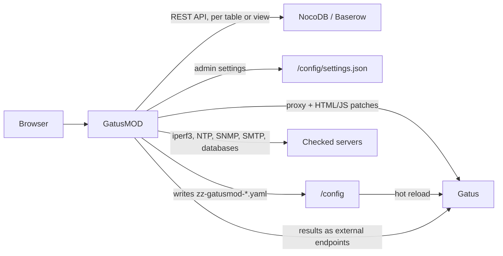

# GatusMOD documentation

GatusMOD sits in front of [Gatus](https://github.com/TwiN/gatus) and adds a database-backed endpoint source, UI patches, an admin page, and public badges. Gatus itself is not modified. See [README.md](README.md) for a short overview and the quick start.

## How it works




- Gatus reads every `*.yaml` file in `GATUS_CONFIG_PATH` (a directory) and ignores unknown keys, so the `gatusmod:` block can live in your Gatus `config.yaml`.
- GatusMOD writes the endpoints of every database table or view to its own file in the same directory (for example `zz-gatusmod-nocodb-prod-http-sites.yaml`), and those of the local tables to `zz-gatusmod-endpoints.yaml`, only when the contents change. Every change makes Gatus reload and restart all checks. Gatus checks for changes every 30 seconds.
- All traffic goes through GatusMOD. Gatus does not publish a port.


## Installation

1. Copy `docker-compose.yml` to your server, or add the `gatusmod` service to an existing Gatus Compose file.
   When the config directory contains no `.yaml`/`.yml` file at startup, GatusMOD writes the example `config.yaml` and the favicons into it. Existing files are never overwritten.
2. Give Gatus a **directory** as its config: `GATUS_CONFIG_PATH=/config` with `./config:/config`, and mount the same directory in GatusMOD.
  With `GATUSMOD_DATA_PATH=/config`, admin settings, including database tokens, are stored as `settings.json` in that same directory (readable only by the container user). Gatus ignores the file because it is not `.yaml`.
   Without `GATUSMOD_DATA_PATH`, GatusMOD uses `/data`. Give that path its own volume, or the settings are lost when the container is recreated.
3. Set `skip-invalid-config-update: true` in the Gatus config so an invalid change does not crash Gatus.
4. Add the `gatusmod:` block (see below) and start: `docker compose up -d --build`.
5. Create an admin password hash:
  ```bash
   docker compose run --rm gatusmod hash-password 'your-password'
  ```
   The output already uses doubled `$$` (Gatus and GatusMOD replace `$VAR` with environment variables). Paste it as-is into `admin.password-bcrypt`.

Gatus will not start if there is no endpoint anywhere. Keep at least one endpoint in `config.yaml`, or start GatusMOD first so the generated file already exists.
The example `config.yaml` has such an endpoint (GatusMOD checking `/mod/health`). Once you have a local table or a database with a table or view,
remove it with **Remove example endpoint** on the admin **Settings** page. GatusMOD only deletes the lines of that endpoint, and refuses while it is the
only endpoint Gatus has.

## Configuration

```yaml
services:
  gatus:
    image: twinproduction/gatus:v5.37.0
    restart: unless-stopped
    environment:
      GATUS_CONFIG_PATH: /config
    volumes:
      - ./config:/config
      - ./config/db:/data
    # No published port: Gatus is only reachable through GatusMOD.
  gatusmod:
    image: ghcr.io/r0gger/gatusmod:latest
    restart: unless-stopped
    depends_on:
      - gatus
    ports:
      - "8080:8080"
    environment:
      GATUSMOD_CONFIG_PATH: /config
      GATUSMOD_DATA_PATH: /config      
    volumes:
      - ./config:/config
      - ./config/favicon:/favicon:ro
      - ./config/public:/public:ro
```

`${VAR}` is replaced by environment variables of the GatusMOD container. `$$` is a literal `$`.
GatusMOD also reloads its own configuration automatically (every 30 seconds).

Everything except `listen`, `upstream`, the directories, and `admin.username` can also be set on the admin page. Values stored there take precedence over the YAML block. *Use config.yaml again* (Settings) makes the general settings fall back to YAML.

### Databases

Manage databases under *Admin > Databases > External Database*. First add a **database**: a NocoDB or Baserow connection with
**Name**, **Provider**, **API URL**, and **Token**. The URL may be the site URL or the API URL (`https://baserow.example.com/api`).
The token is never shown again. Leave the field empty to keep the current token.

A database has one or more **tables/views** (*Add table/view*). Each reads the rows of a table (optionally only a **view**) and turns
each row into one Gatus endpoint, with its own primary check, schedule, and column mapping. So one table can have a view with `http` checks,
one with `database` checks, and one with `iperf3` checks. A table/view is shown as `database:name`, for example `NocoDB-prod:http-sites`.
The page shows the databases as an accordion, with their tables/views below each one.

Per table/view:

- **Name, group, Table ID, View ID**.
- **Primary check**: `http` (`https://{host}`), `tcp` (`tcp://{host}:{port}`), `icmp` (`icmp://{host}`), or `custom` (URL from a column).
Checked by GatusMOD itself (see [Protocols](#protocols)): `iperf3` (`iperf3://{host}:{port}`), `ntp` (`ntp://{host}:{port}`),
`snmp` (`snmp://public@{host}:{port}`), `smtp` (`smtp://{host}:{port}`), `database` (URL from a column or template), and `push` (no check).
A custom **URL template** overrides this. Placeholders: `{host}`, `{port}`, `{ports}` (the whole range or list), `{id}`, `{group}`, or a column name (`{Hostname}`).
- **Name template** (default `{host}`) when there is no name column, a **group** for every endpoint (unless a group column is mapped),
**default ports** (for example `5201-5210`; a range or list checks the first port), and **conditions**
(default `[STATUS] == 200` for http/custom, `[CONNECTED] == true` for tcp/icmp).
- **Interval**: how often each generated endpoint is checked. The table/view itself is read on the same interval by default,
aligned to the clock (for `15m`: :00, :15, :30, :45). Enable *Manual schedule* for a custom cron expression
(`*/30 * * * *`, `@hourly`, `@every 10m`), or leave it empty to read it only by hand (*Run*).
- **Column mapping**: for each Gatus setting (name, group, url, host, port, method, interval, conditions, status, extra), the column name.
A filled column takes precedence over the template and the default. *Status*: `true` (checked) = enabled,
`false` (unchecked) = disabled; without a Status column every row is enabled. *Test connection and preview* loads the column names and shows the first endpoints.

Every table/view is written to its own file, named after it: `NocoDB-prod:http-sites` becomes `zz-gatusmod-nocodb-prod-http-sites.yaml`
(lowercase; `:`, spaces and other characters become `-`). The first line of the file names the table/view, so GatusMOD recognizes its files.
Two tables/views that would get the same file name are rejected. An endpoint that is in more than one table/view is written only once.
If a database call fails, the last rows read for that table/view are kept. Until a table/view has been read at least once after startup, its file is not rewritten.
Renaming a database or table/view renames the file.

Deleting a table/view asks for confirmation and then deletes its file; deleting a database deletes all its tables/views and their files.
Generated files whose table/view no longer exists are never deleted automatically: they are listed under *Orphaned files*, each with a *Delete* button.

An existing `gatusmod.database` block is converted on first start into the database `NocoDB` (or `Baserow`) with the table/view `database`
(the fixed column names below, and `sync-interval` as the schedule). After that you manage it on the admin page; the YAML block is ignored.
Imports from older versions are grouped into databases by provider, URL, and token, and their endpoints move from `zz-gatusmod-endpoints.yaml` to their own files.

### Database table with fixed columns

For a `custom` table/view with the default mapping (and for *YAML import*), use these columns:


| Column       | Type               | Contents                                                               |
| ------------ | ------------------ | ---------------------------------------------------------------------- |
| `name`       | text               | required                                                               |
| `group`      | text               |                                                                        |
| `url`        | text               | required                                                               |
| `method`     | text               | for example `GET`, `POST`                                              |
| `interval`   | text               | for example `30s`, `5m`; empty = `defaults.interval`                   |
| `conditions` | long text          | one condition per line, for example `[STATUS] == 200`                  |
| `disabled`   | checkbox / boolean | checked = `enabled: false` in Gatus                                    |
| `extra`      | long text          | other Gatus settings as YAML (alerts, headers, body, dns, client, ...) |


Invalid rows (missing name, URL, or condition; invalid interval; broken `extra` YAML; duplicate group + name) are
skipped and shown on the admin page. The remaining endpoints keep working. If the database call fails,
the last generated file is left in place.

Tokens:

- **NocoDB**: *Team & Settings > API Tokens*. The table id is in the URL or under *Details > API snippets*.
- **Baserow**: *Settings > Database tokens* (read, create, and update). The table id is in the URL.


#### Baserow under a different host name

The Baserow all-in-one image only forwards `/api/...` to its backend when the host name of the request is in `BASEROW_PUBLIC_URL`
(or `BASEROW_EXTRA_PUBLIC_URLS`). Other host names go to the web frontend, which answers every API call with a 404:

```text
Test failed: Reading the rows failed: GET /api/database/rows/table/47/: HTTP 404:
{ "error": true, "url": "http://host.docker.internal:8082/api/...", "statusCode": 404, "statusMessage": "Server Error", "message": "Server Error" }
```

This happens when GatusMOD reaches Baserow at another address than the one in your browser, for example `http://host.docker.internal:8082`
or `http://baserow` (container name) while `BASEROW_PUBLIC_URL=http://localhost:8082`. Add the address GatusMOD uses to the Baserow container
and recreate it:

```yaml
services:
  baserow:
    image: baserow/baserow:2.4.1
    environment:
      BASEROW_PUBLIC_URL: http://localhost:8082
      BASEROW_EXTRA_PUBLIC_URLS: http://host.docker.internal:8082
      BASEROW_EXTRA_ALLOWED_HOSTS: host.docker.internal
```

`BASEROW_EXTRA_PUBLIC_URLS` makes Baserow route `/api/` to the backend for that host name (comma-separated for more than one),
and `BASEROW_EXTRA_ALLOWED_HOSTS` makes the backend accept it. A correctly routed request without a valid token returns 401 instead of 404.

### Local endpoint tables

Without NocoDB or Baserow, manage endpoints under *Admin > Databases > Local Database*. A table is a grid where every row becomes one Gatus endpoint.
The local tables are written to `zz-gatusmod-endpoints.yaml`, and a table is read again as soon as you save it (Gatus picks the change up within 30 seconds).

- **Name, group, interval, conditions** of the table are the defaults for rows that leave those cells empty.
Without conditions, rows use `[STATUS] == 200`, or `[CONNECTED] == true` for tcp, icmp, and the [Protocols](#protocols) of GatusMOD.
- **Columns**: tick the [Gatus endpoint settings](https://gatus.io/docs/endpoints) you need. `name` and `url` are always on.
  - Basic: `group`, `method`, `interval`, `conditions` (one per line), Status (true/checked = enabled, false/unchecked = disabled; new rows start checked).
  - HTTP: `graphql`, `body`, `headers` (YAML mapping).
  - DNS: `dns.query-type`, `dns.query-name`. SSH: `ssh.username`, `ssh.password`.
  - Advanced: `client`, `ui`, `extra-labels` (YAML mappings), `alerts`, `maintenance-windows` (YAML lists), and `extra` (any other setting as a YAML mapping).
  A dedicated column wins over the same key in `extra`.
- Cells with invalid YAML or an unknown option are marked and nothing is saved. Rows that cannot become an endpoint
(no name or url, an unknown placeholder, a duplicate group + name) are saved, but skipped and listed below the grid.
- Unticking a column hides it; its values are removed when you save.
- `url` may be any Gatus URL or a GatusMOD protocol such as `iperf3://host:5201`, `ntp://pool.ntp.org`, or `push://backup`.
For those, only `alerts`, `maintenance-windows`, and `heartbeat` (in `extra`) are used from the other columns.

The rows are stored in `settings.json` (readable only by the container user), so cells may hold passwords. `${VAR}` in a probe URL is
still read from the environment. The YAML import cannot write into a local table.

## Protocols

GatusMOD checks a few protocols Gatus cannot check itself. Use their URL in the `url` column of an import or a local table, the URL template, or one of the
primary checks above. Instead of an `endpoints:` entry, GatusMOD writes an
[external endpoint](https://github.com/TwiN/gatus#external-endpoints) for each one (name, group, token, heartbeat), runs the check on the endpoint's interval,
and sends the result (up/down, error, response time) to Gatus. The dashboard, uptime, badges, alerts, and the Statistics table work as usual.


| URL                                                                                | Check                                                    | Placeholders for conditions                                                                              |
| ---------------------------------------------------------------------------------- | -------------------------------------------------------- | -------------------------------------------------------------------------------------------------------- |
| `iperf3://host:5201`                                                               | iperf3 handshake: ready, or busy while another test runs | `[CONNECTED]`, `[RESPONSE_TIME]`, `[STATE]` (`ready`, `busy`, `error`), `[PORT]`, `[BANDWIDTH]` (Mbit/s) |
| `ntp://host[:123]`                                                                 | one NTP query                                            | `[CONNECTED]`, `[RESPONSE_TIME]` (round trip), `[OFFSET]` (absolute clock offset), `[STRATUM]`           |
| `snmp://community@host:161/1.3.6.1.2.1.1.3.0`                                      | SNMP GET of one OID (default `sysUpTime.0`)              | `[CONNECTED]`, `[RESPONSE_TIME]`, `[VALUE]`                                                              |
| `smtp://host:25`, `smtps://host:465`                                               | banner and EHLO                                          | `[CONNECTED]`, `[RESPONSE_TIME]`, `[CODE]` (banner, `220` = ready), `[CERTIFICATE_EXPIRATION]`           |
| `postgres://`, `mysql://`, `redis://`, `rediss://`, `mongodb://`, `mongodb+srv://` | login and ping                                           | `[CONNECTED]` (login accepted), `[RESPONSE_TIME]`, `[RESULT]`                                            |
| `push://`                                                                          | none: a script reports the status                        | none                                                                                                     |


Options (query parameters):

- All: `timeout=10s` (default).
- iperf3: `ports=5201-5210` tries the next port while a port is busy (the `iperf3` primary check adds this when the row has a range).
`bandwidth=3s` also runs a single-stream TCP bandwidth test of that length (maximum 60s), on every check, at the interval of the endpoint (also a per-row interval column). `bandwidth-interval=6h` tests less often; the other checks are a handshake only.
`reverse=true` measures the download instead of the upload (iperf3 `-R`). `rate=1M` caps the test at that bitrate (iperf3 `-b`; `K`, `M`, `G`),
so the test only shows whether data gets through and uses little bandwidth. `ip=4` or `ip=6` forces IPv4 or IPv6 (iperf3 `-4`/`-6`).
Bandwidth tests run one at a time. Between tests, `[BANDWIDTH]` is the last measured value;
before the first test, conditions on `[BANDWIDTH]` are skipped. A busy server is tried again on the next check. A failed test marks the endpoint down.
The tests of the last 30 days are kept in `iperf3-history.json` in the data directory: the Statistics table on the endpoint page shows the share
of passed tests (and without `rate`, the average bandwidth) per period, and after a restart the schedule continues instead of testing at once.
Changing the direction or the rate starts a new series.

  | Goal                               | URL (template)                                     | Like                           |
  | ---------------------------------- | -------------------------------------------------- | ------------------------------ |
  | Only the handshake (no data)       | `iperf3://{host}:{port}`                           |                                |
  | Upload speed                       | `iperf3://{host}:{port}?bandwidth=5s`              | `iperf3 -c host -t 5`          |
  | Download speed                     | `iperf3://{host}:{port}?bandwidth=5s&reverse=true` | `iperf3 -c host -t 5 -R`       |
  | Does a test pass, with little data | `iperf3://{host}:{port}?bandwidth=5s&rate=1M&ip=4` | `iperf3 -c host -t 5 -b 1M -4` |

- NTP: `max-offset=500ms` is the same as the condition `[OFFSET] <= 500ms`.
- SNMP: `version=1|2c|3` (default `2c`). For v3: `snmp://user@host/oid?version=3&auth=sha&auth-pass=...&priv=aes&priv-pass=...`
(auth `md5`, `sha`, `sha224`, `sha256`, `sha384`, `sha512`; priv `des`, `aes`, `aes192`, `aes256`).
- SMTP: `starttls=true` requires STARTTLS (port 587), `insecure=true` skips certificate verification, `ehlo=name` (default `gatusmod`).
- Databases: the URL is passed to the driver (for example `sslmode=disable` for PostgreSQL, `tls=true` for MySQL). `query=` runs a query after
the ping, and `[RESULT]` is the first value: SQL for PostgreSQL and MySQL (`query=SELECT%201`), a command for Redis (`query=GET%20mykey`),
and a JSON command for MongoDB (`query=%7B%22ping%22%3A1%7D`).

Conditions use the Gatus syntax: `==`, `!=`, `<`, `<=`, `>`, `>=`, `len([VALUE])`, and `pat(*text*)`. Times are compared in milliseconds,
or as a duration (`[OFFSET] < 100ms`, `[CERTIFICATE_EXPIRATION] > 48h`). Without conditions the defaults are `[CONNECTED] == true`
(plus `[CODE] == 220` for SMTP). A busy iperf3 server counts as up. Use `[STATE] == ready` to count it as down.
Rows with an unknown placeholder or an invalid option are skipped and shown on the admin page.

Passwords:

- `${VAR}` in a probe URL is replaced with an environment variable of the GatusMOD container (`postgres://app:${PG_PASSWORD}@db/app`).
Only the `${...}` form is replaced, so a password may contain `$`. Special characters in a password must be URL-encoded (`@` is `%40`).
- Probe URLs are not written to the generated file, and the admin page and the errors sent to Gatus hide the password.

Push endpoints: GatusMOD shows a push URL per endpoint on the admin overview (`/mod/push/<token>`). Call it from a cron job or script:

```bash
curl -fsS "https://status.example.com/mod/push/<token>?status=up&ping=120"
curl -fsS "https://status.example.com/mod/push/<token>?status=down&msg=backup+failed"
```

`status` is `up` (default) or `down`, `msg` is shown as the error, and `ping` is the response time in milliseconds. GET and POST both work,
and one push per second is accepted. Without a push within the interval, Gatus marks the endpoint down.
Active checks get a heartbeat of twice their interval, so they also go down when GatusMOD stops.

`extra` (YAML) only uses `alerts`, `heartbeat`, and `maintenance-windows` for these endpoints. The token and the push URLs come from
`probeSecret` in `settings.json`. If that file is lost, the push URLs change.

Test a URL from the command line:

```bash
docker compose run --rm gatusmod probe "ntp://pool.ntp.org" "[OFFSET] < 100ms"
docker compose run --rm gatusmod probe "iperf3://iperf.example.org:5201?bandwidth=3s" "[BANDWIDTH] > 100"
```


## Admin page

`/mod/admin` is available only when `gatusmod.admin` is set. Log in with `admin.username` and the password.

- **Overview**: sync status, last error, skipped rows, generated endpoints, the probes (last result, values, next run, push URLs), and the result of the UI patches.
- **Databases**, with two tabs:
  - *Local Database*: the [local endpoint tables](#local-endpoint-tables), edited in a grid.
  - *External Database*: add, edit, and delete databases and their tables/views, and read a table/view now (*Run*). Each table/view shows its file, schedule, the next run,
  and the last run (*183 endpoints from 183 rows in 227ms*).
- **Settings**: base URL, default interval, items per page, heading and subtitle, clock (12-hour or 24-hour) and date notation
(DD/MM/YYYY or MM/DD/YYYY), footer, favicons, analytics, and the admin password. The clock and date notation can also be set
in YAML as `ui.time-format: 24h` and `ui.date-format: DD/MM/YYYY`; left empty, the browser decides.
- **Status pages**: add, edit, and delete the [status pages](#status-pages).
- **Badges**: the *Embed badge* generator (period, style, content, overall/group/import, Markdown/HTML/URL) and, per endpoint,
Gatus's health, uptime, response-time, and chart badges. If the Gatus API is protected (`security:`),
endpoints from the databases and local tables are used.
- **Backup & import**:
  - *Backup*: download the configuration as one YAML file: the external databases, their tables/views (mapping, schedule,
  templates), the local tables with their rows, the settings, the status pages, and the probe secret. The API tokens and the
  password hashes of the private status pages are only included when you tick the box. Not included: the rows in NocoDB/Baserow,
  the Gatus history (`data.db`), and the admin password.
  - *Restore*: upload a backup. *Merge* updates databases, tables and views with the same ID or name, adds the others, and
  keeps the current probe secret. *Replace* makes the configuration exactly the backup (including its probe secret, so push
  URLs stay the same) and deletes what is not in it. A database without a token in the backup keeps its current token, and
  a private status page without a password keeps its current password. A private status page that is new on this
  installation stays private with an unknown password until you set one.
  - *Import Gatus endpoints*: paste or upload an existing Gatus config. Every `endpoints:` entry is added or updated in the
  chosen database table/view (matched on group + name). The table/view must have columns for at least name and url.

Security:

- Session cookie (`HttpOnly`, `SameSite=Strict`, `Secure` behind HTTPS or `X-Forwarded-Proto: https`), valid for 12 hours.
Sessions are kept in memory: after a GatusMOD restart you log in again.
- Every form has a CSRF token, and cross-site posts are rejected. Pages use a strict Content-Security-Policy.
- After 5 failed logins from the same IP address, login is blocked for 15 minutes. Behind a reverse proxy every
visitor shares the proxy's IP, so the block then applies to everyone.
- Changing the password (at least 10 characters) logs out every other session. The new password is stored in `settings.json`
and takes precedence over `admin.password-bcrypt`.


### Public uptime badge

`GET /mod/badges/uptimes/{1h|24h|7d|30d}/badge.svg` returns the average uptime of multiple endpoints, without login:


| Parameter | Values                                                                      |
| --------- | --------------------------------------------------------------------------- |
| `check`   | `overall` (default), `group:<group>`, or `import:<id>` (a table/view)       |
| `style`   | `flat` (default), `flat-square`, `plastic`                                  |
| `content` | `percentage` (default) or `percentage-endpoints` (`99.69% · 183 endpoints`) |
| `label`   | custom text on the left (default `uptime 30d`)                              |


The result is cached for 5 minutes. Use the generator on the Badges page to build the URL and the snippet.

## Status pages

A status page shows the dashboard with only the endpoints of one or more groups and of single endpoints, for example
one per customer. Manage them under **Status pages** in the admin: a slug, the groups, single endpoints, an optional
password, an optional title (browser tab), heading and subheading (empty uses the values of the main site), and zero or
more domains. They are stored in `settings.json` and kept when you use *Use config.yaml again*.

- **On the main site**: `https://<base-url>/status/<slug>`. The browser then shows `/?status=<slug>`, and the
endpoint pages keep `?status=<slug>`, so a reload or a shared link stays on the status page. For a public page this is
a filtered view, not access control: the main site still shows its endpoints.
- **On a mapped domain** (e.g. `status.customer-a.com`) the status page is the whole site at `/`. Only the endpoints
of the page can be read: other endpoints, suites, `/metrics`, the rest of the Gatus API, `/mod/admin`,
`/mod/badges` and `/status/...` answer 404. `[baseurl]` (footer, favicons) becomes the domain itself. Push URLs
(`/mod/push/...`) keep working.


### Private status pages

Give a status page a password (at least 10 characters) to make it private. Visitors share that password:

- Opening the page (on its domain, or at `/status/<slug>` on the main site) redirects to `/mod/status-login`. Without a
login, the API answers 401. Only the assets of the dashboard (scripts, styles, images), `/mod/static/`, `/mod/health`
and push URLs are available.
- After the login the page shows a *Log out* button. The login is valid for 12 hours, per domain (on the main site for
one private page at a time). After 5 wrong passwords from the same IP address, the login is blocked for 15 minutes.
Logins are kept in memory, so after a restart of GatusMOD visitors log in again. Changing the password of the page logs
out all its visitors.
- The endpoints of a private page are **hidden everywhere else**: on the main dashboard, in the Gatus API of the main
site (`/api/v1/endpoints/statuses` leaves them out, `/api/v1/endpoints/<key>/...` answers 404), in `/mod/api/endpoints/...`,
in the uptime badges of `/mod/badges`, and on the other status pages. When an endpoint is on a private page and on
a public page, the private page wins: only the private page shows it. The admin pages still show every endpoint.

Gatus itself still knows these endpoints: `/metrics` on the main site (when Gatus metrics are enabled), the suites,
alerts, and anybody who can reach Gatus directly are not filtered.

Point the DNS record of each domain to GatusMOD, and add the domain to your TLS certificate / reverse proxy. The
reverse proxy must pass the original `Host` header (and `X-Forwarded-Proto: https` behind TLS). A domain may not be
the host of `base-url`, and every domain belongs to one status page. After deleting a status page, a domain that
still points to GatusMOD shows the whole dashboard again.

Endpoints are matched to groups on their key (`<group>_<name>`), the same way Gatus builds it. Single endpoints are
stored by key; endpoints Gatus does not know yet can be entered by key under *Other endpoints*. The main site uses
`/mod/static/statuspage.js` to keep the slug in the URL and send it as the `X-GatusMOD-Status-Page` header with
the API requests of the dashboard; that relies on the routes of the Gatus UI (tested with `v5.37.0`).

## Statistics table

On an endpoint detail page (`/endpoints/{key}`), GatusMOD replaces the response-time badges,
"Uptime Statistics", and "Current Health" with one **Statistics** table for 30 days, 7 days, 24 hours, and 1 hour:

- **Response time**: average response time (only when Gatus also shows the response-time chart).
- **Overall (status)**: uptime of the endpoint itself.
- **Ping (ICMP)**: uptime of an ICMP endpoint (`icmp://...`) with the same host as the endpoint, for example
`https://host.example.org` and `icmp://host.example.org`. If the same host has several ICMP endpoints, the one
in the same group wins. Without an ICMP endpoint, or when the endpoint itself is ICMP, this row is omitted.

Colors: green from 95%, orange from 90% up to 95%, red below 90%, grey when that period has no data.
The table refreshes every minute while the page is visible.

Gatus does not expose an endpoint's type and URL through the API, so GatusMOD reads `endpoints:` from every
YAML file in the config directory (including the generated file). The public API
`GET /mod/api/endpoints/{key}/related` returns the type, the host, and the key of the ICMP endpoint
(`{"type":"http","host":"host.example.org","icmp":"servers_ping"}`).

## Limitations

- `items-per-page`, hiding the heading, and the 24-hour chart axis work by patching the Gatus UI. After a Gatus upgrade a patch
may no longer match. GatusMOD logs that and shows it on the admin page (*UI patches*). Pin the Gatus image tag
(tested with `v5.37.0`).
- Gatus reloads within 30 seconds of a change, and then restarts all checks.
- `defaults.interval` applies only to endpoints from imports, not to endpoints you write by hand in `config.yaml`.
- Cron schedules use the container timezone (UTC by default).
- The extra protocols only work for endpoints from imports and local tables. An `iperf3://` URL written by hand in `config.yaml` is invalid
for Gatus: it rejects the file, and Gatus v5.37 then stops serving the dashboard until the file is valid again.
- Gatus itself already checks TCP ports and the certificate of a mail server (`starttls://host:587`, `tls://host:465`).
Use `smtp://` when you also want the banner code and EHLO.
- A new external endpoint can only receive results once Gatus has reloaded (within 30 seconds). GatusMOD retries the first result once.


## Development

```bash
go test ./...                          # unit tests
powershell -File e2e/run.ps1           # end-to-end: NocoDB + Gatus + GatusMOD (+ iperf3, PostgreSQL, MariaDB, Redis, MongoDB, Mailpit) in docker compose
powershell -File e2e/run.ps1 -KeepRunning   # stack stays up at http://localhost:18080
```

